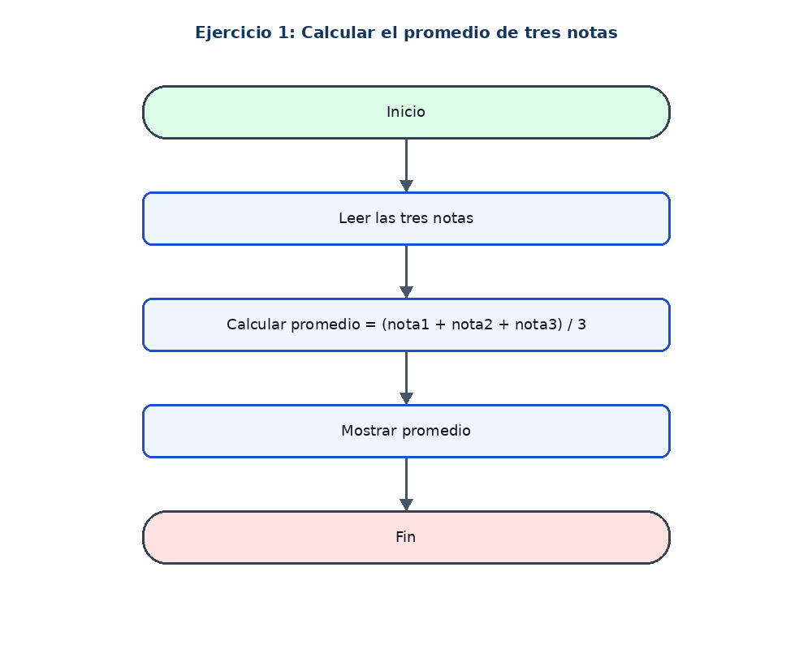

# Ejercicio 1: Calcular el promedio de tres notas

## Enunciado

Leer tres notas y calcular su promedio.

## Análisis

**Datos de entrada:** nota1, nota2 y nota3 (reales).

**Proceso:** Sumar las tres notas y dividir entre 3.

**Datos de salida:** El promedio.

## Pseudocódigo en PSeInt

```text
Algoritmo Calcular_Promedio
Definir nota1, nota2, nota3, promedio Como Real
Escribir "Ingrese la primera nota:"
Leer nota1
Escribir "Ingrese la segunda nota:"
Leer nota2
Escribir "Ingrese la tercera nota:"
Leer nota3
promedio <- (nota1 + nota2 + nota3) / 3
Escribir "El promedio es: ", promedio
FinAlgoritmo
```

## Diagrama de flujo


