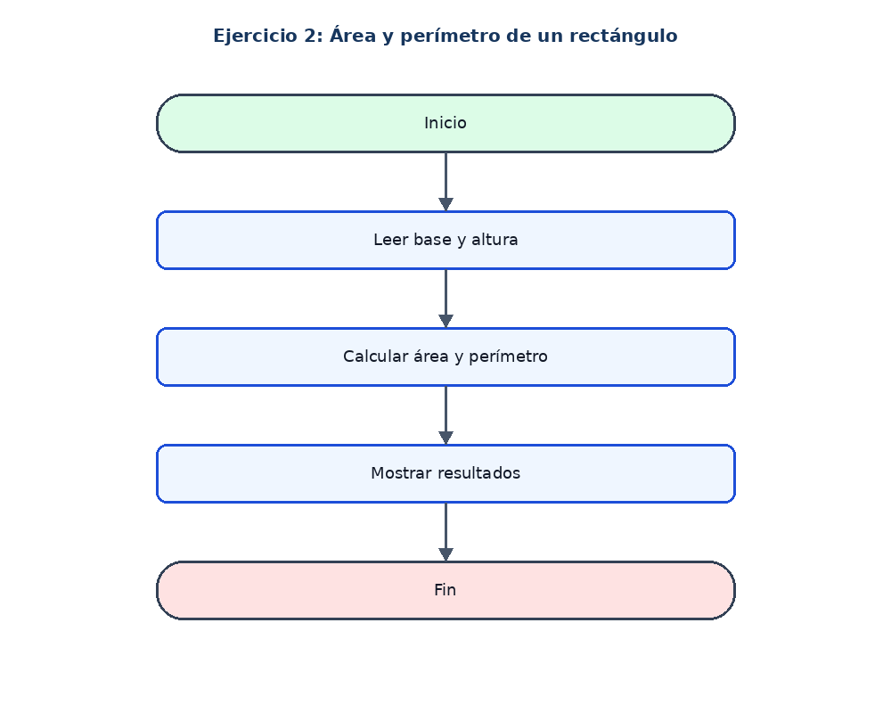

# Ejercicio 2: Área y perímetro de un rectángulo

## Enunciado

Leer base y altura y calcular el área y el perímetro.

## Análisis

**Datos de entrada:** base y altura (reales).

**Proceso:** área = base * altura; perímetro = 2 * (base + altura).

**Datos de salida:** Área y perímetro.

## Pseudocódigo en PSeInt

```text
Algoritmo Area_Perimetro_Rectangulo

	// Definir las variables para guardar la base, altura, area y perimetro
	Definir base, altura, area, perimetro Como Real

	// Solicitar y guardar la base del rectangulo
	Escribir "Ingrese la base:"
	Leer base

	// Solicitar y guardar la altura del rectangulo
	Escribir "Ingrese la altura:"
	Leer altura

	// Calcular el area multiplicando la base por la altura
	area <- base * altura

	// Calcular el perimetro sumando la base y la altura y multiplicando por 2
	perimetro <- 2 * (base + altura)

	// Mostrar los resultados obtenidos
	Escribir "El area es: ", area
	Escribir "El perimetro es: ", perimetro

FinAlgoritmo
```

## Diagrama de flujo


