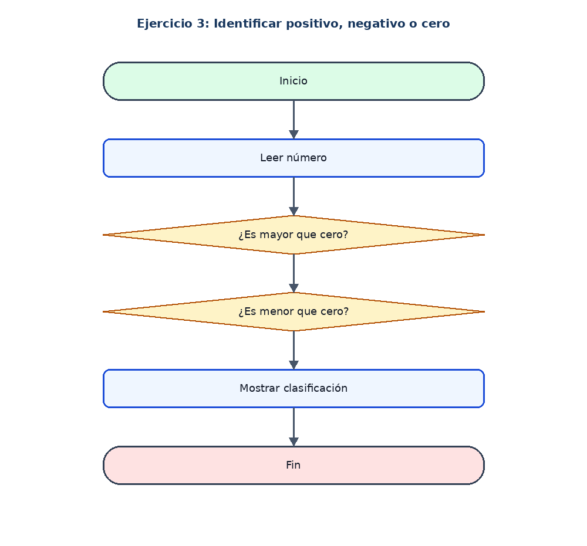

# Ejercicio 3: Identificar positivo, negativo o cero

## Enunciado

Leer un número y determinar si es positivo, negativo o cero.

## Análisis

**Datos de entrada:** numero (real).

**Proceso:** Comparar el número con cero mediante condicionales.

**Datos de salida:** Clasificación del número.

## Pseudocódigo en PSeInt

```text
Algoritmo Numero_Positivo_Negativo

	// Definir la variable que almacenara el numero ingresado
	Definir numero Como Real

	// Solicitar y guardar un numero
	Escribir "Ingrese un numero:"
	Leer numero

	// Comprobar si el numero es mayor que cero
	Si numero > 0 Entonces
		Escribir "El numero es positivo"

	// Si no es positivo, comprobar si es menor que cero
	SiNo
		Si numero < 0 Entonces
			Escribir "El numero es negativo"

		// Si no es mayor ni menor que cero, significa que es cero
		SiNo
			Escribir "El numero es cero"
		FinSi
	FinSi

FinAlgoritmo
```

## Diagrama de flujo


