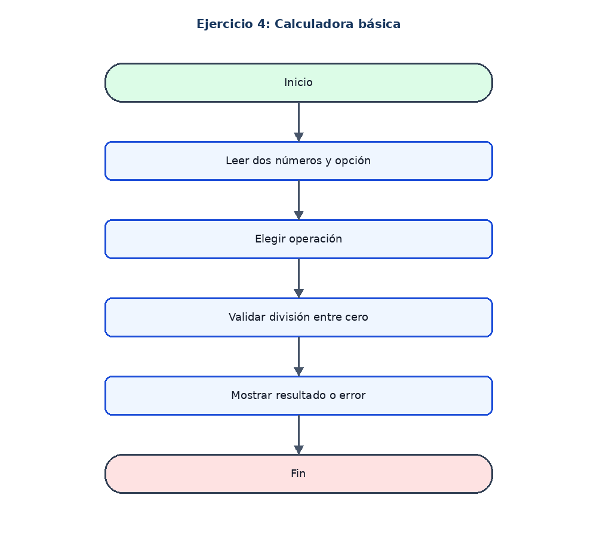

# Ejercicio 4: Calculadora básica

## Enunciado

Leer dos números y una opción para sumar, restar, multiplicar o dividir.

## Análisis

**Datos de entrada:** numero1 y numero2 (reales); opcion (entero).

**Proceso:** Usar Segun para elegir la operación y validar que el divisor no sea cero.

**Datos de salida:** Resultado o mensaje de error.

## Pseudocódigo en PSeInt

```text
Algoritmo Calculadora_Basica
Definir numero1, numero2, resultado Como Real
Definir opcion Como Entero
Escribir "Ingrese el primer numero:"
Leer numero1
Escribir "Ingrese el segundo numero:"
Leer numero2
Escribir "1. Sumar  2. Restar  3. Multiplicar  4. Dividir"
Leer opcion
Segun opcion Hacer
    1:
        resultado <- numero1 + numero2
        Escribir "Resultado: ", resultado
    2:
        resultado <- numero1 - numero2
        Escribir "Resultado: ", resultado
    3:
        resultado <- numero1 * numero2
        Escribir "Resultado: ", resultado
    4:
        Si numero2 <> 0 Entonces
            resultado <- numero1 / numero2
            Escribir "Resultado: ", resultado
        SiNo
            Escribir "No se puede dividir entre cero"
        FinSi
    De Otro Modo:
        Escribir "Opcion no valida"
FinSegun
FinAlgoritmo
```

## Diagrama de flujo


