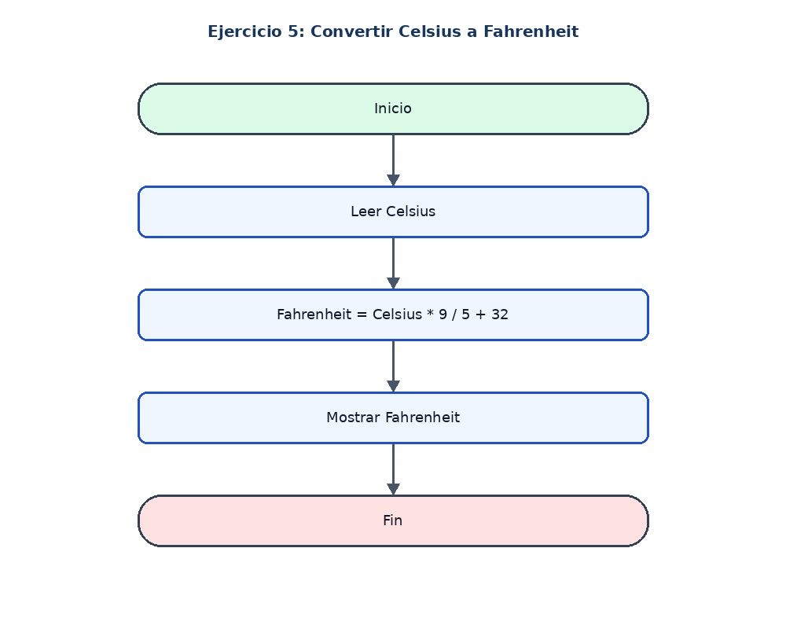

# Ejercicio 5: Convertir Celsius a Fahrenheit

## Enunciado

Leer temperatura Celsius y convertirla a Fahrenheit.

## Análisis

**Datos de entrada:** celsius (real).

**Proceso:** fahrenheit = celsius * 9 / 5 + 32.

**Datos de salida:** Temperatura Fahrenheit.

## Pseudocódigo en PSeInt

```text
Algoritmo Celsius_A_Fahrenheit
Definir celsius, fahrenheit Como Real
Escribir "Ingrese la temperatura en Celsius:"
Leer celsius
fahrenheit <- celsius * 9 / 5 + 32
Escribir "Temperatura en Fahrenheit: ", fahrenheit
FinAlgoritmo
```

## Diagrama de flujo


