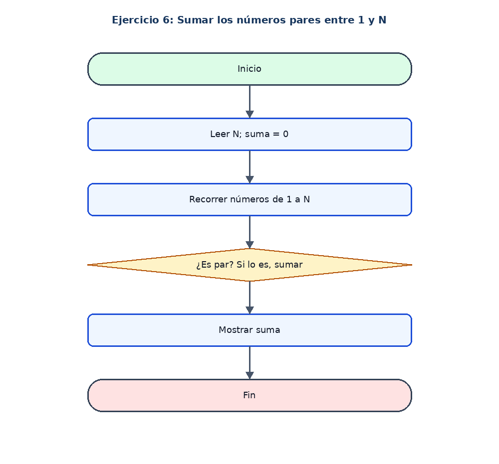

# Ejercicio 6: Sumar los números pares entre 1 y N

## Enunciado

Leer N y sumar los números pares desde 1 hasta N.

## Análisis

**Datos de entrada:** N (entero).

**Proceso:** Recorrer del 1 al N y sumar los valores cuyo residuo al dividir entre 2 sea 0.

**Datos de salida:** Suma de los pares.

## Pseudocódigo en PSeInt

```text
Algoritmo Sumar_Numeros_Pares
Definir n, i, suma Como Entero
suma <- 0
Escribir "Ingrese un numero limite:"
Leer n
Para i <- 1 Hasta n Hacer
    Si i MOD 2 = 0 Entonces
        suma <- suma + i
    FinSi
FinPara
Escribir "La suma de los pares es: ", suma
FinAlgoritmo
```

## Diagrama de flujo


