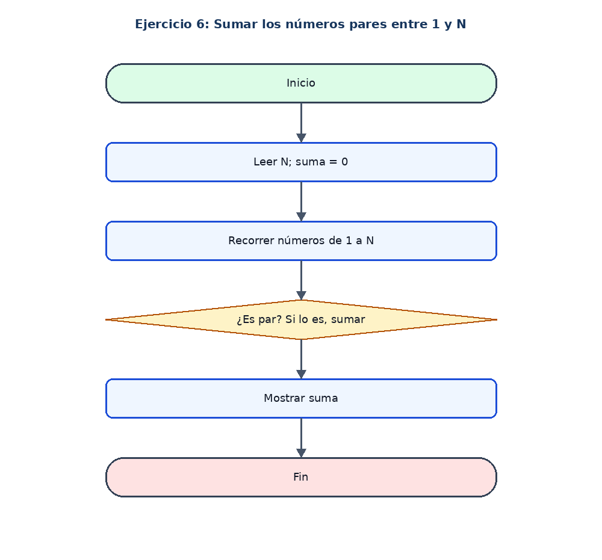

# Ejercicio 6: Sumar los números pares entre 1 y N

## Enunciado

Leer N y sumar los números pares desde 1 hasta N.

## Análisis

**Datos de entrada:** N (entero).

**Proceso:** Recorrer del 1 al N y sumar los valores cuyo residuo al dividir entre 2 sea 0.

**Datos de salida:** Suma de los pares.

## Pseudocódigo en PSeInt

```text
Algoritmo Sumar_Numeros_Pares

	// Definir las variables para el limite, contador y suma
	Definir n, i, suma Como Entero

	// Inicializar la suma en cero
	suma <- 0

	// Solicitar y guardar el numero limite
	Escribir "Ingrese un numero limite:"
	Leer n

	// Recorrer los numeros desde 1 hasta el limite ingresado
	Para i <- 1 Hasta n Hacer

		// Comprobar si el numero actual es par
		Si i MOD 2 = 0 Entonces

			// Agregar el numero par a la suma total
			suma <- suma + i

		FinSi
	FinPara

	// Mostrar el resultado de la suma de los numeros pares
	Escribir "La suma de los pares es: ", suma

FinAlgoritmo
```

## Diagrama de flujo


