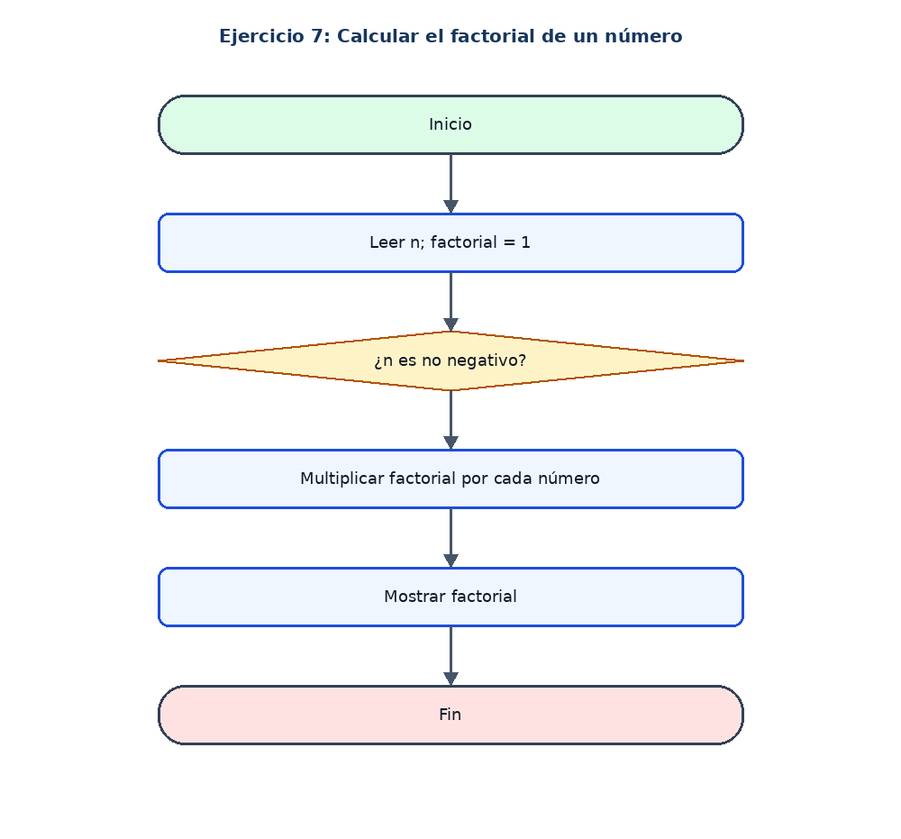

# Ejercicio 7: Calcular el factorial de un número

## Enunciado

Leer un entero no negativo y calcular su factorial.

## Análisis

**Datos de entrada:** n (entero no negativo).

**Proceso:** Iniciar factorial en 1 y multiplicar por cada entero desde 1 hasta n.

**Datos de salida:** Factorial de n. El factorial de 0 es 1.

## Pseudocódigo en PSeInt

```text
Algoritmo Calcular_Factorial
Definir n, i, factorial Como Entero
factorial <- 1
Escribir "Ingrese un numero entero no negativo:"
Leer n
Si n >= 0 Entonces
    Para i <- 1 Hasta n Hacer
        factorial <- factorial * i
    FinPara
    Escribir "El factorial es: ", factorial
SiNo
    Escribir "El numero debe ser no negativo"
FinSi
FinAlgoritmo
```

## Diagrama de flujo


