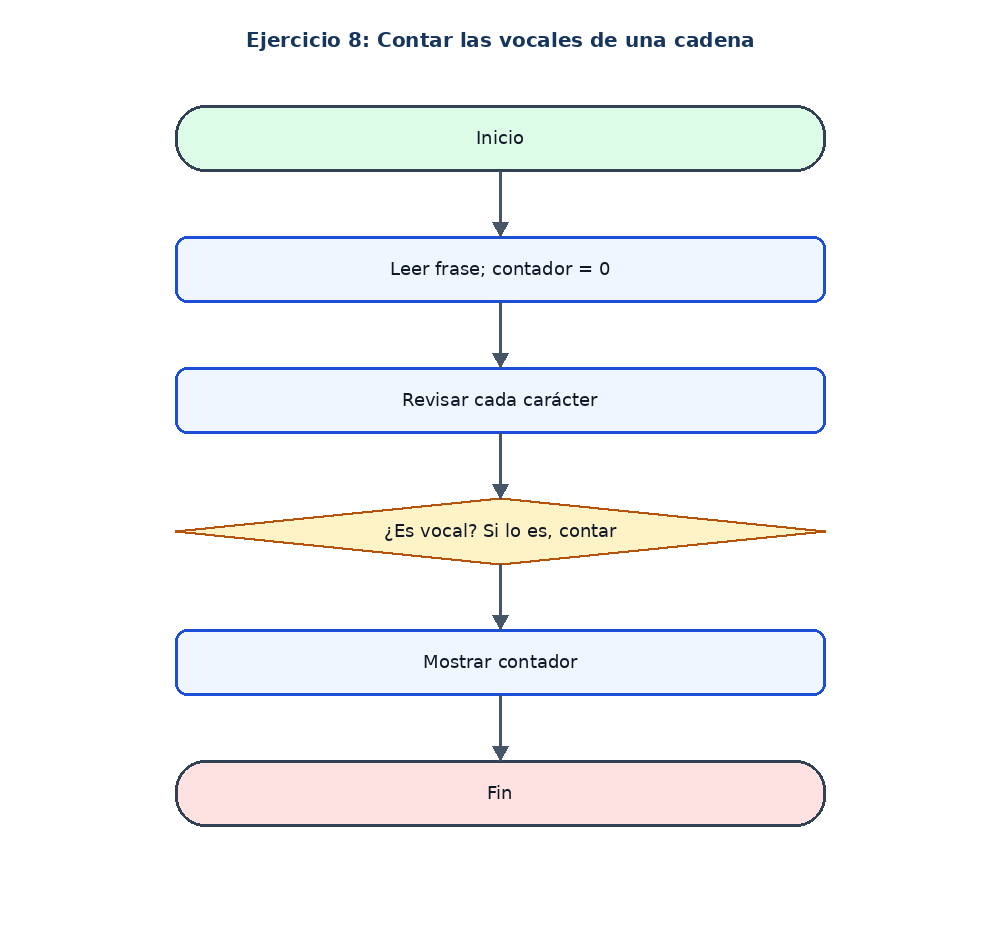

# Ejercicio 8: Contar las vocales de una cadena

## Enunciado

Leer una frase y contar cuántas vocales contiene.

## Análisis

**Datos de entrada:** frase (cadena).

**Proceso:** Recorrer cada carácter, pasarlo a minúscula y contar a, e, i, o, u.

**Datos de salida:** Cantidad de vocales.

## Pseudocódigo en PSeInt

```text
Algoritmo Contar_Vocales
Definir frase, letra Como Cadena
Definir i, contador Como Entero
contador <- 0
Escribir "Ingrese una frase:"
Leer frase
Para i <- 0 Hasta Longitud(frase) - 1 Hacer
    letra <- Minusculas(Subcadena(frase, i, i))
    Si letra = "a" O letra = "e" O letra = "i" O letra = "o" O letra = "u" Entonces
        contador <- contador + 1
    FinSi
FinPara
Escribir "Cantidad de vocales: ", contador
FinAlgoritmo
```

## Diagrama de flujo


