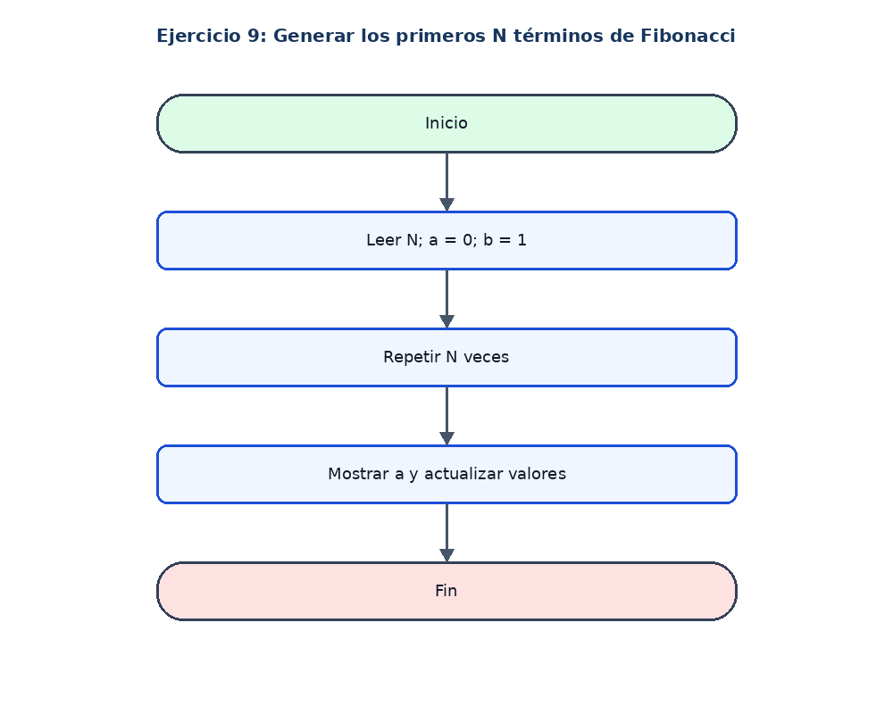

# Ejercicio 9: Generar los primeros N términos de Fibonacci

## Enunciado

Leer N y mostrar los primeros N términos de Fibonacci.

## Análisis

**Datos de entrada:** N (entero).

**Proceso:** Iniciar a = 0 y b = 1; mostrar a y actualizar los valores N veces.

**Datos de salida:** Los primeros N términos.

## Pseudocódigo en PSeInt

```text
Algoritmo Serie_Fibonacci
Definir n, i, a, b, temporal Como Entero
a <- 0
b <- 1
Escribir "Cuantos terminos desea mostrar?"
Leer n
Para i <- 1 Hasta n Hacer
    Escribir a
    temporal <- a + b
    a <- b
    b <- temporal
FinPara
FinAlgoritmo
```

## Diagrama de flujo


