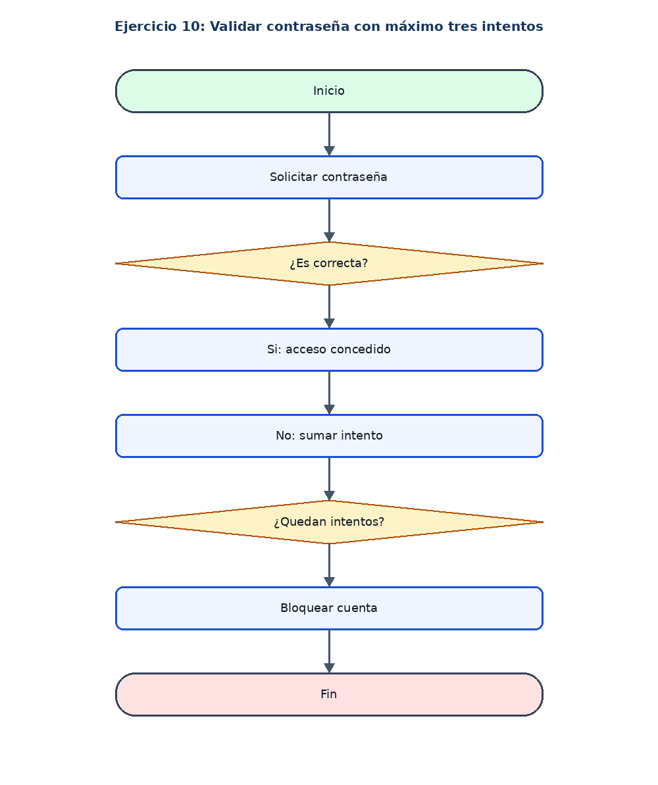

# Ejercicio 10: Validar contraseña con máximo tres intentos

## Enunciado

Solicitar una contraseña y permitir máximo tres intentos. La clave correcta es 12345.

## Análisis

**Datos de entrada:** Clave ingresada (cadena).

**Proceso:** Repetir mientras haya intentos disponibles y no se haya acertado.

**Datos de salida:** Acceso concedido o cuenta bloqueada.

## Pseudocódigo en PSeInt

```text
Algoritmo Validar_Contrasena
Definir clave, ingreso Como Cadena
Definir intentos Como Entero
Definir acceso Como Logico
clave <- "12345"
intentos <- 0
acceso <- Falso
Mientras intentos < 3 Y acceso = Falso Hacer
    Escribir "Ingrese la contrasena:"
    Leer ingreso
    Si ingreso = clave Entonces
        acceso <- Verdadero
    SiNo
        intentos <- intentos + 1
        Escribir "Contrasena incorrecta"
    FinSi
FinMientras
Si acceso Entonces
    Escribir "Acceso concedido"
SiNo
    Escribir "Cuenta bloqueada"
FinSi
FinAlgoritmo
```

## Diagrama de flujo


