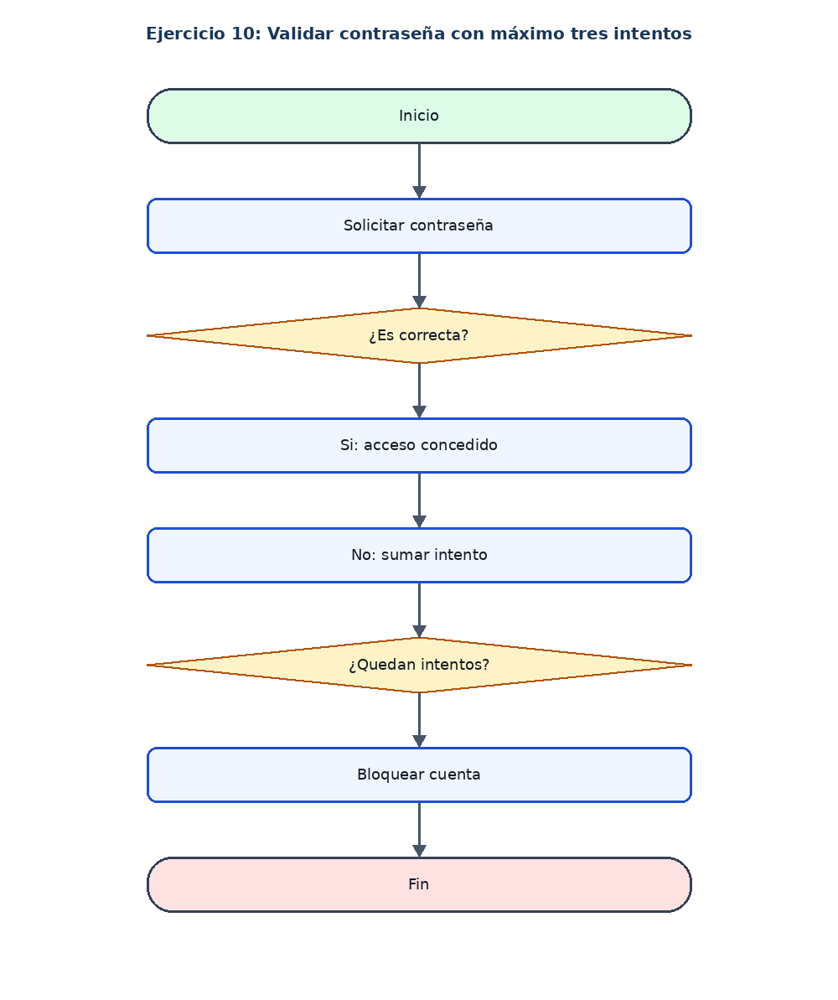

# Ejercicio 10: Validar contraseña con máximo tres intentos

## Enunciado

Solicitar una contraseña y permitir máximo tres intentos. La clave correcta es 12345.

## Análisis

**Datos de entrada:** Clave ingresada (cadena).

**Proceso:** Repetir mientras haya intentos disponibles y no se haya acertado.

**Datos de salida:** Acceso concedido o cuenta bloqueada.

## Pseudocódigo en PSeInt

```text
Algoritmo Validar_Contrasena

	// Definir las variables para la clave correcta y la clave ingresada
	Definir clave, ingreso Como Cadena

	// Definir la variable para contar los intentos
	Definir intentos Como Entero

	// Definir una variable logica para comprobar el acceso
	Definir acceso Como Logico

	// Asignar la contraseña correcta
	clave <- "12345"

	// Inicializar el contador de intentos en cero
	intentos <- 0

	// Indicar que el acceso inicialmente no esta permitido
	acceso <- Falso

	// Repetir mientras queden intentos y no se haya ingresado la clave correcta
	Mientras intentos < 3 Y acceso = Falso Hacer

		// Solicitar y guardar la contraseña ingresada
		Escribir "Ingrese la contrasena:"
		Leer ingreso

		// Comprobar si la contraseña ingresada es correcta
		Si ingreso = clave Entonces

			// Permitir el acceso cuando la contraseña sea correcta
			acceso <- Verdadero

		// Si la contraseña es incorrecta, aumentar los intentos
		SiNo
			intentos <- intentos + 1

			// Informar que la contraseña ingresada es incorrecta
			Escribir "Contrasena incorrecta"
		FinSi

	FinMientras

	// Comprobar si el acceso fue permitido
	Si acceso Entonces

		// Mostrar el mensaje de acceso concedido
		Escribir "Acceso concedido"

	// Si no se acerto la contraseña, bloquear la cuenta
	SiNo
		Escribir "Cuenta bloqueada"
	FinSi

FinAlgoritmo
```

## Diagrama de flujo


